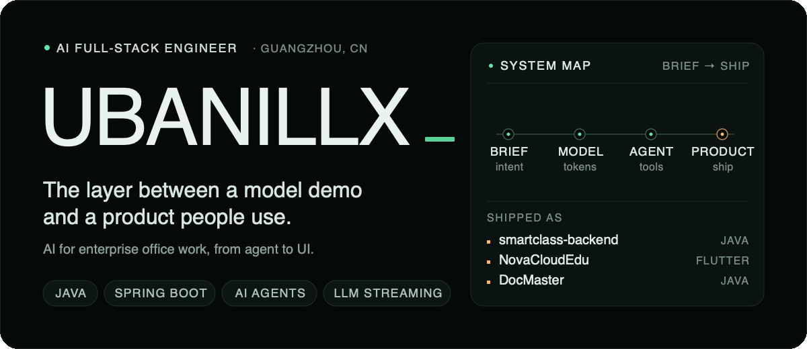
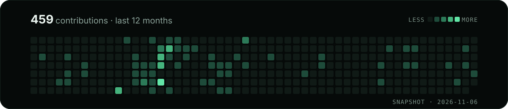
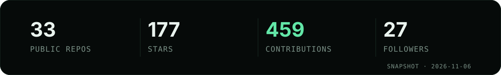

<b>English</b> · <a href="#中文">中文</a>

  <picture>
    <source media="(max-width: 600px)" srcset="./assets/readme/hero-mobile.svg" type="image/svg+xml">
    <source media="(prefers-reduced-motion: reduce)" srcset="./assets/readme/hero.svg" type="image/svg+xml">
    
  </picture>

I'm Ubanillx, an AI full-stack application engineer in Guangzhou, China. I build AI for enterprise office work: agent-assisted workflows, internal tools, streaming chat, and the full stack behind them.

I'm deep into vibe coding, and I've tried enough agent platforms to have opinions.

`Java` · `Spring Boot` · `LangChain4j` · `Python` · `React` · `TypeScript` · `Docker`

## Selected work

Three projects that made it out of the demo.

**[smartclass-backend](https://github.com/Ubanillx/smartclass-backend)**  
`Java` · `Spring Boot` · `Dify`  
The backend for an AI learning platform: chat, courses, and daily study content through the Dify API.

**[NovaCloudEdu](https://github.com/Ubanillx/NovaCloudEdu)** · [live](https://novacloudedu.ubanillx.com/)  
`Dart` · `Flutter` · `Spring Boot`  
An AI + education SaaS for web and mobile: courses, classes, e-books, and progress tracking, with an assistant, knowledge base, MCP workflows, and recommendations on top.

**[DocMaster](https://github.com/Ubanillx/DocMaster)**  
`Java` · `Spring Boot` · `Docker`  
A document-conversion service built around Dockerized LibreOffice: 13 formats, 100 MB uploads, a web UI, and a REST API.

## Writing · 藏经阁

Notes from the build log. Most posts are written in Chinese; the summaries below are in English. Some of them even worked on the first try.

**[Harness Engineering: from code generation to system delivery](https://blog.ubanillx.com/posts/72fb5804-c8a8-4b62-a317-ee4cc5cf5fe9)** `中文`  
A task contract and a reliable control plane, so an agent can deliver a system instead of stopping at code.

**[ego lite: a browser shared with your agent, without losing your tabs](https://blog.ubanillx.com/posts/89599afc-20ad-459e-bf82-c906d3927693)** `中文`  
Separate spaces for human and agent, shared login state, and no fight over the same window.

**[WebSocket in LLM apps: from streaming tokens to high-performance chat](https://blog.ubanillx.com/posts/14091297-6cc1-413f-bd2d-3846ec4c1d8a)** `中文`  
What it takes to move token streaming from a demo to a high-performance chat system.

[All posts →](https://blog.ubanillx.com)

## 代码修行 / Code cultivation

33 public repos, 177 stars, 27 followers, 459 contributions in the last 12 months. The grid and board are a snapshot; the streak card is live. The live profile is on [GitHub](https://github.com/Ubanillx).

  

  

  

More green squares, higher survival rate. A blank square means I was probably arguing with a product manager that day.

## Field notes from the 代码江湖

> "My IDE is a magic wand. My terminal is a gatling gun that fires blue flames."  
> — still true.

**Questionable achievements**  
`01` `git push --force` survival rate: 100%.  
`02` Predicted the next `npm install` failure within ±3 minutes.  
`03` Debugged a spacecraft control system with `console.log` (fictional).  
`04` Made Swagger generate memes (patent pending).

## Elsewhere

[Blog](https://blog.ubanillx.com) · [GitHub](https://github.com/Ubanillx) · [X](https://x.com/LiuLongxin38647) · [Contact](https://blog.ubanillx.com/about)

Open to AI projects, especially the ones stuck between demo and production.

<em>I like the part where the demo becomes a product.</em>

---

## 中文

<a href="#top">English ↑</a>

我是 Ubanillx，一名 AI 全栈应用工程师，现居广州。现在主要做 AI 在企业办公里的落地：Agent 辅助的工作流、内部工具、流式对话，以及支撑它们的前后端。

我热衷 vibe coding，用过很多智能体平台，已经有一套自己的偏好。

`Java` · `Spring Boot` · `LangChain4j` · `Python` · `React` · `TypeScript` · `Docker`

### 精选项目

三个从 Demo 里活下来的项目。

**[smartclass-backend](https://github.com/Ubanillx/smartclass-backend)** · `Java` · `Spring Boot` — AI 学习平台的后端：聊天、课程和每日学习资料，接的是 Dify API。

**[NovaCloudEdu](https://github.com/Ubanillx/NovaCloudEdu)** · [在线体验](https://novacloudedu.ubanillx.com/) · `Dart` · `Flutter` · `Spring Boot` — 面向 Web 和移动端的 AI + 教育 SaaS，在课程、班级、电子书和学习进度之上，加了 AI 助手、知识库、MCP 工作流和推荐。

**[DocMaster](https://github.com/Ubanillx/DocMaster)** · `Java` · `Spring Boot` · `Docker` — 围绕容器化的 LibreOffice 搭的文档转换服务：13 种格式、100 MB 上传、Web 界面和 REST API。

### 写作

构建日志，多数用中文写；也有几次一次就跑通。

- **[Harness Engineering：把 AI 编码从“能写代码”推进到“能交付系统”](https://blog.ubanillx.com/posts/72fb5804-c8a8-4b62-a317-ee4cc5cf5fe9)**
- **[ego lite：让 AI agent 与你共享浏览器，却不抢你的标签页](https://blog.ubanillx.com/posts/89599afc-20ad-459e-bf82-c906d3927693)**
- **[WebSocket 在大模型应用中的真实落地：从流式输出到高性能对话系统](https://blog.ubanillx.com/posts/14091297-6cc1-413f-bd2d-3846ec4c1d8a)**

[全部文章 →](https://blog.ubanillx.com)

### 代码修行

33 个公开仓库、177 个 star、27 位关注者、最近 12 个月 459 次贡献。网格和数字板是快照，streak 卡是实时的；实时主页在 [GitHub](https://github.com/Ubanillx)。

绿色方块越多，渡劫成功率越高；白色方块，那天可能在和产品经理「论道」。

### 代码江湖

> “我的 IDE 是魔法杖，终端是冒蓝火的加特林。”——这句还作数。

**玄学成就墙**  
`01` `git push --force` 生存大师，存活率 100%。  
`02` 精准预判下一次 `npm install` 失败，误差 ±3 分钟。  
`03` 用 `console.log` 调试航天器控制系统（虚构）。  
`04` 让 Swagger 文档自动生成表情包（专利待申请）。

### 找到我

[博客](https://blog.ubanillx.com) · [GitHub](https://github.com/Ubanillx) · [X](https://x.com/LiuLongxin38647) · [联系](https://blog.ubanillx.com/about)

如果你在做 AI 产品，卡在 Demo 到上线之间，欢迎来聊。

<em>我喜欢 Demo 变成产品的那一段。</em>

